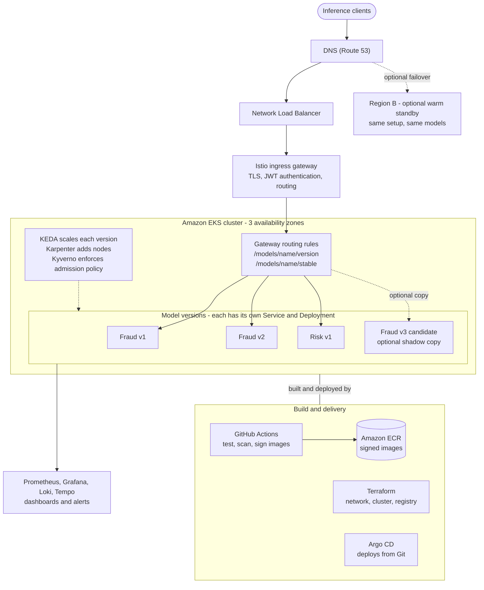
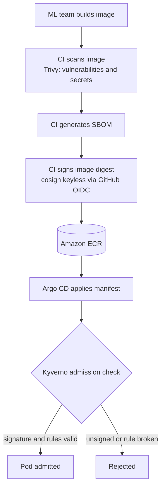
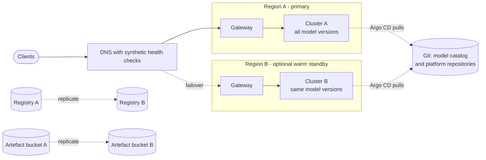
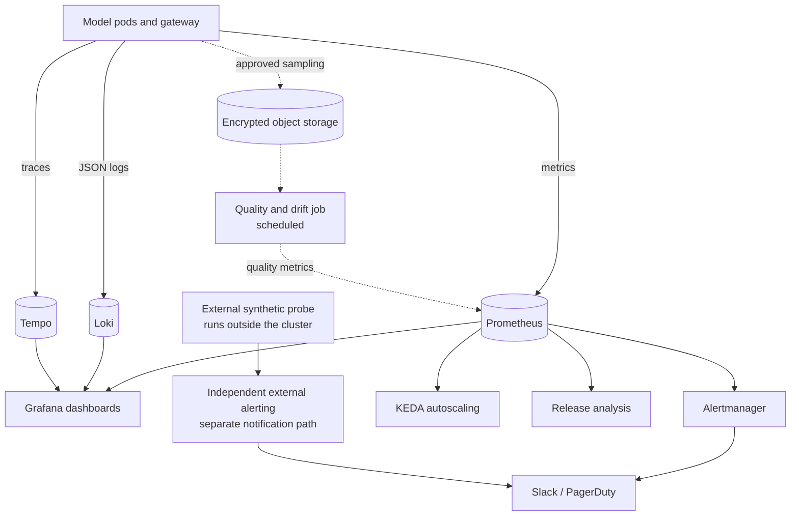
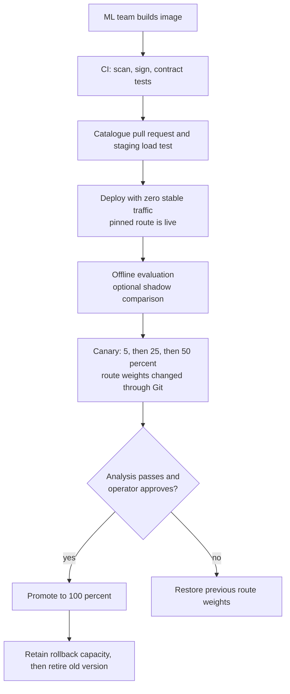

# Scalable Model Inference Service: Design Proposal

All diagrams are included inline and render on GitHub. Their editable Mermaid sources are in the `diagrams/` folder.

## Summary

This document proposes a platform for hosting machine learning models that are delivered by the ML team as Docker images. Each image serves inference requests one at a time through predefined HTTP endpoints. The platform must host several models, and several versions of each model, at the same time, and every version must scale independently according to demand.

**Proposed solution.** The platform runs on Amazon EKS (managed Kubernetes). Every model version is deployed as its own Kubernetes Deployment and Service. An ingress gateway routes each request either to a pinned version or to a `stable` alias. Each version is scaled by its own autoscaler, based on measured inference concurrency, and cluster nodes are added or removed automatically. All infrastructure, deployment and routing configuration is stored in Git and applied through reviewed changes.

**Scope and phasing.** The initial production design uses one region across three availability zones. Capabilities that add cost or operational complexity are specified as optional extensions, to be adopted when a stated requirement justifies them.

| Category | Content |
|---|---|
| Included from the start | One deployment per model version; gateway routing with pinned and stable routes; per-version autoscaling; GitOps delivery; image scanning, signing and admission policies; metrics, logs, traces and alerting; staged releases with approval gates |
| Optional extensions | Warm standby in a second region; ambient service mesh with workload mTLS; automated progressive delivery; shadow-traffic comparison; scale-to-zero for non-critical versions |
| Out of scope | Streaming responses; batch and asynchronous inference; stateful models |

### Where each requirement is addressed

| Requirement | Section |
|---|---|
| Docker images with fixed HTTP endpoints; many models and versions at once | 1, 2.1, 2.2 |
| Independent scaling per version | 2.3 |
| Architecture, resiliency and reliability | 2 |
| Infrastructure toolkit | 3 |
| Monitoring and observability | 4 |
| Rolling out a new model version | 5.1 |
| Updating infrastructure and services | 5.2, 5.3 |
| Reasoning behind the choices | 6 |

---

## 1. Requirements and assumptions

- Models arrive as Docker images and serve individual inference requests through predefined HTTP endpoints. The platform preserves those endpoints and rewrites only the external routing prefix.
- Several models and versions run simultaneously and scale independently. Requests are synchronous HTTP. Streaming, batching and asynchronous jobs are outside the initial scope.
- Model servers are assumed to be stateless between requests. Any stateful model requires an explicit storage and recovery design before it is onboarded.
- Each image must declare its port, endpoints, request and response contract, startup behaviour, resource needs and owner. Existing health endpoints are preferred. Where none exist, an agreed wrapper or probe adapter is required.
- Traffic volumes, image sizes, GPU requirements and business recovery targets have not been supplied. Replica counts and thresholds in this document are starting examples to be validated by load tests. They are not measured capacity claims.

---

## 2. Architecture and reliability

### 2.1 Overview



The request path is as follows.

- A client request is resolved by DNS and passed through the Network Load Balancer to one of several Istio ingress gateway replicas.
- The gateway terminates TLS, authenticates the caller and applies the routing rules, which select the model version.
- Each model version has its own Service and Deployment. Versions share no pods, so a fault in one version does not directly affect another. Shared nodes, gateways and cluster services remain common failure domains (see 2.4).
- Cluster controllers scale pods and nodes and enforce admission policy.
- Terraform builds the cloud infrastructure. GitHub Actions builds, scans and signs images. Argo CD deploys the reviewed configuration from Git.

### 2.2 Request routing

| Example URL | Meaning | Intended users |
|---|---|---|
| `/models/fraud/v2/predict` | Pinned route to Fraud v2 | Clients that require stable behaviour; the ML team for testing |
| `/models/fraud/stable/predict` | The promoted version, or a weighted canary during a release | Most clients |

- The gateway rewrites the model and version prefix, so the container receives its own endpoint (for example `/predict`).
- Separate Services keep pinned routes independent of any change to the stable route.
- Version identifiers and image digests are immutable. A retired version receives a documented deprecation period and is not silently changed.
- The gateway validates the JWT issuer, audience and expiry. Authorisation policies restrict callers to permitted models and versions.
- Client rate limits require an explicitly configured rate-limit service. JWT validation alone does not provide them.

### 2.3 Independent scaling and capacity

**Pod scaling.** KEDA creates one Horizontal Pod Autoscaler (HPA) for each Deployment and reads a concurrency signal from Prometheus. There is exactly one replica controller per workload. A second, independently configured HPA must not be added, because the two would compete.

- The model server, or a small agreed instrumentation adapter, exports the number of active requests. Gateway latency and error metrics are available without changing model code, but they do not provide application queue depth or inference execution spans.
- CPU utilisation is a poor scaling signal for inference. A GPU-bound model can be saturated while its CPU appears idle.
- For a server that handles one request per pod at a time, execution concurrency is enforced at one, and the initial target is below one busy request per ready pod to leave headroom. If an image runs several workers, its safe concurrency is benchmarked.
- The scaler query, metric type, zero-traffic result and behaviour when metrics are unavailable are specified and tested. Latency and GPU utilisation are supporting diagnostic signals, not the sole scaling input.

**Replica limits.** Production versions keep at least two ready replicas. Low-traffic test versions keep at least one. Scale-to-zero is excluded from the initial design, because ordinary per-pod metrics cannot activate an HTTP service that has no pods. It can be added later for non-critical versions using an HTTP activation and buffering component, together with an agreed cold-start experience.

**Node scaling.** Karpenter provisions nodes when pods cannot be scheduled.

- CPU and memory requests and limits, maximum replicas, namespace quotas and maximum node-pool capacity are set for every version.
- GPU models request explicit GPU resources and use a tainted GPU node pool with matching tolerations, compatible drivers and device plugins. GPU sharing is avoided until memory isolation and throughput have been tested.
- Image pull, node provisioning, model loading and warm-up are benchmarked separately. Warm headroom is kept for expected bursts, because autoscaling cannot absorb arbitrary instant demand.

**Overload behaviour.** Bounded queues, maximum body sizes, deadlines and concurrency limits apply. The platform returns 429 for client throttling and 503 for unavailable capacity, with documented retry guidance. Automatic inference retries are disabled by default and permitted only for confirmed idempotent operations, within the original deadline and a small retry budget.

### 2.4 Availability and failure boundaries

| Risk | Mitigation |
|---|---|
| Node or zone failure | Model and gateway replicas are spread across hosts and zones with topology spread constraints or anti-affinity. Surviving capacity is sized for the agreed zone-loss scenario |
| Pod not yet able to serve | A startup probe covers long model loads. Readiness is reported only after the model has loaded and a warm-up request has succeeded |
| Healthy process restarted unnecessarily | Liveness checks do not fail merely because a dependency is slow |
| Voluntary disruption (upgrades, node replacement) | A PodDisruptionBudget (for example `minAvailable: 1` for a two-replica version), controlled surge and unavailability settings, and Karpenter disruption budgets |
| Pod stopped during a request | Readiness is withdrawn at shutdown, connections drain, and in-flight requests finish within the termination grace period and request deadline |
| Traffic spike | Autoscaling, warm headroom, concurrency limits and bounded queues |
| One version consuming excess resources | CPU and memory limits, namespace quotas and priority classes |
| Large image pulls | In-region registry, images pulled by digest, pre-pulled GPU images on new nodes |
| Cluster controller failure | Critical controllers run on reliable capacity, and their redundancy and recovery are tested separately |

Two points are stated explicitly.

- Two replicas occupy two zones, not three. Replica count alone does not guarantee availability. Capacity must be sized so that the remaining zones can carry the load after a zone loss.
- A PodDisruptionBudget limits qualifying voluntary evictions only. It does not prevent node crashes, zone failures or every controller action.

### 2.5 Network and workload security

- Model pods run in private subnets. Default-deny NetworkPolicies are enforced by a supporting network plugin. Model pods accept inference traffic only from authorised gateway and platform workloads, and egress is restricted to necessary DNS, telemetry and artefact access.
- The initial design uses Istio as an ingress gateway with VirtualService routing. It does not enrol model workloads in a mesh. This avoids a second data plane and waypoint requirements.
- If end-to-end workload encryption or service identity is required, an ambient service mesh (or application-level TLS) is added as an extension. In ambient mode, the node-level ztunnel component provides mutual TLS between pods, workload identity, and layer 4 authorisation and telemetry. HTTP-level (layer 7) routing, authorisation and request telemetry are not automatic. They require waypoint proxies, which are additional components to deploy and operate. Gateway metrics already provide HTTP request, error and latency data for each model version, so waypoints are added only where layer 7 policy inside the cluster is required.

### 2.6 Supply chain security and admission control

Model images are produced by another team and are therefore verified before they run.



- CI scans each image, generates a software bill of materials (SBOM) and signs the image digest with cosign. Keyless signing ties the signature to the CI identity, so no long-lived signing key has to be protected.
- Admission policy (Kyverno) verifies the expected signing identity and issuer, the approved registry and an immutable digest. It also requires non-root execution, restricted privileges, resource limits and required ownership labels (`model`, `version`, `owner`).
- A valid signature proves provenance. It does not prove the absence of vulnerabilities, which the scan addresses separately.
- Admission rules start in audit mode with a deadline to enforce. Controls required for production are enabled before production traffic is served.

### 2.7 Optional second region

A single region across three zones tolerates node and zone failures but not a regional outage. A warm standby region is an optional extension. It is funded only after the business agrees a recovery time objective (RTO) for service recovery and a recovery point objective (RPO) for configuration and model artefacts.



- Both clusters are built from the same Terraform modules and the same Git catalogue. A standby requires replicated image digests, model files, encryption permissions, secrets, routing and compatible gateway authorisation.
- GPU capacity in the standby region is reserved or otherwise verified. A smaller standby cannot immediately carry full production demand.
- Synthetic inference health checks, which send a real prediction request, drive an explicit failover policy. Safeguards prevent a single broken model from moving every healthy model.
- DNS failover is affected by health-detection time and resolver caching. Detection, DNS propagation, scale-up, model loading and client recovery are measured in drills. Failback and cross-region data residency are documented. No regional recovery time is promised before those tests.
- New versions are promoted one region at a time, with observation between regions.

---

## 3. Infrastructure toolkit and security

Infrastructure is managed in three layers. All of it is defined as code in Git.

| Layer | Content | Managed with |
|---|---|---|
| 1. Cloud infrastructure | VPC and private worker networking, EKS, IAM, ECR, load balancer integration, DNS, encryption keys | Terraform |
| 2. Cluster add-ons | Istio gateway, KEDA, Karpenter, Kyverno, Prometheus, Grafana, Loki, Tempo, External Secrets | Argo CD |
| 3. Model catalogue | One manifest per model version | Argo CD ApplicationSet and a shared Helm chart |

| Tool | Purpose | Rationale |
|---|---|---|
| Terraform | Cloud resources | Reviewable plans and repeatable environments. Remote encrypted state with locking and versioning, and separate state per environment and region. Terragrunt is introduced only if repeated stacks justify it |
| Argo CD | Reconciles add-ons and model configuration from Git | Git is the source of truth, drift is corrected and rollback is a reviewed Git change |
| Helm chart (`model-service`) | Shared, versioned template for every model version | Platform defaults (probes, limits, budgets, network rules) live in the chart and are not copied by each model team. ApplicationSet generates applications as the catalogue grows |
| Istio ingress gateway | Routing, TLS, JWT and policy enforcement | Mature weighted routing without enrolling workloads in a mesh |
| KEDA | Per-version pod scaling | Scales on a custom concurrency metric |
| Karpenter | Node provisioning | Right-sized nodes, including a separate GPU pool |
| Kyverno, cosign, Trivy | Admission policy, signing, scanning | Reject unsigned or non-compliant images |
| GitHub Actions | Validation, contract checks, scanning, SBOM, signing | CI proposes Git changes. Argo CD performs deployment, so CI holds no cluster credentials |
| External Secrets | Secrets from AWS Secrets Manager | Secrets are never stored in Git |
| Prometheus, Grafana, Loki, Tempo | Telemetry | Open, vendor-neutral, and the same data drives scaling and release checks |

**Credentials and access.** CI uses short-lived cloud credentials. Workloads receive narrowly scoped IAM roles (IAM roles for service accounts, or EKS Pod Identity), for example read access only to that model's artefacts. Production Terraform apply uses its own approved cloud role. Add-ons are version-pinned and introduced only when needed.

**Model catalogue.** The manifest for each version records the model and version, immutable image, port and endpoints, health contract, owner, resource requests and limits (declared separately for CPU and memory), GPU needs, minimum and maximum replicas, tested concurrency target, SLO, and regional placement. CI rejects missing or inconsistent values.

```yaml
name: fraud
version: v2
owner: ml-fraud-team
image: <registry>/ml/fraud@sha256:...      # immutable digest, never a tag
port: 8080
endpoints: [/predict]
health: { startup: /healthz, ready: /readyz }
resources:
  requests: { cpu: "2", memory: 4Gi }
  limits:   { cpu: "4", memory: 4Gi }   # memory limit equals request
  gpu: 0                                  # whole GPUs only; 0 for CPU models
scaling:
  minReplicas: 2
  maxReplicas: 40
  targetConcurrencyPerPod: 0.7       # example only; set from load tests
slo: { availability: 99.9, p95LatencyMs: 300 }
rollout:
  shadow: { enabled: false }         # optional; requires a capture path
  canarySteps: [5, 25, 50, 100]
  promotion: operator-approved
regions: [eu-west-2]
```

---

## 4. Monitoring and observability



**Metrics.** Request rate, errors and latency histograms are collected by model, version and region at the gateway. Additional metrics include ready replicas, pending pods, restarts, out-of-memory kills, model load time, active inference requests and resource saturation, with GPU exporter metrics where relevant. Label cardinality is bounded: request IDs, user IDs and raw paths are not metric labels. Cost per 1,000 requests is derived per model.

**Service level objectives.** An example initial objective is 99.9% successful eligible requests over a rolling 30-day window, and 95% of eligible requests completing within 300 ms, measured at the gateway including internal queuing. Model-specific objectives are agreed from benchmarks and user needs. Service-generated overload failures count against availability. Exclusions such as invalid client input are documented, and client throttling is distinguished from capacity exhaustion. Synthetic and mirrored traffic is labelled separately from user traffic.

**Alerting.** Sustained fast error-budget burn pages the on-call engineer. Slower burn raises tickets. Named model and platform owners, runbooks and escalation paths are defined. Further alerts cover gateway availability, pending GPU capacity, stale metrics, expiring certificates, failed Git reconciliation and artefact access. Alert delivery is tested. An external synthetic probe running outside the cluster notifies the on-call engineer through an independent path, such as a hosted uptime service with its own notification channel, and not through the in-cluster Alertmanager. A continuously firing watchdog alert from Alertmanager is sent to an external receiver, which raises a notification if it stops arriving. Together these ensure that a failure of the monitoring stack itself still produces a notification.

**Logs and traces.** Logs are JSON and carry a request or trace ID. The gateway forwards trace context, and the model continues it where it supports instrumentation. Gateway-only tracing cannot expose model execution internals. Sampling, retention, access controls and storage limits are set. Request and response bodies are not logged by default.

**Model quality and drift.** Model quality is tracked separately from service availability. With approved sampling, encryption, retention and privacy controls, candidate predictions are compared against a reference using request correlation. Natural input drift alerts the model owner and does not trigger an automatic rollback, because drift can reflect a genuine change in the data rather than a fault. Regression thresholds for a candidate version are a separate release decision, using agreed reference data and, where available, later ground-truth accuracy.

---

## 5. Operations

### 5.1 Releasing a new model version



1. **Build and validate.** The immutable image is built and tested for startup, health behaviour, endpoint compatibility, response schema, resource consumption and representative inference correctness, together with the ML owner. Throughput, tail latency, overload and cold starts are load-tested in staging.
2. **Review and deploy dark.** A catalogue pull request is reviewed. The new version is deployed with warm minimum replicas and a working, authorised pinned route, but zero stable traffic. The previous version remains available.
3. **Offline and shadow evaluation.** Offline comparisons are run. Sampled shadow traffic is optional. Mirroring alone discards responses, so output comparison needs an instrumented capture and comparison path. Writes and other production side effects are disabled in shadow execution, and its resource budget is capped. Shadowing is skipped where privacy or side effects cannot be controlled.
4. **Canary.** Stable-route weights are changed through reviewed Git changes, for example 5%, 25%, 50% and then 100%. CI and analysis jobs query canary and baseline metrics. Each stage has a minimum sample count, an observation window, latency and error thresholds and agreed model-quality checks. Missing telemetry blocks promotion. At low traffic, the window is extended or an approved offline evaluation is used instead of claiming statistical confidence.
5. **Approval and rollback.** Initially, an operator approves each promotion after analysis. A failed gate stops the rollout and the operator restores the previous route weights. Because Argo CD reconciliation makes this a controlled GitOps change, rollback time is measured and not assumed. Automated progressive delivery (for example Argo Rollouts) can be adopted once the workflow and thresholds are proven.
6. **Retire.** The old version and sufficient warm rollback capacity are retained for an agreed window. The old version is removed only after pinned-client usage has been checked and deprecation communicated. If a standby region exists, promotion proceeds one region at a time.

### 5.2 Updating infrastructure

- **Terraform changes.** Every change is a pull request with a reviewed plan. Apply proceeds through development, staging and production, one region at a time where applicable. Backup, restore and destructive changes are checked explicitly. Critical resources are protected with IAM and change controls, not only lifecycle flags. Drift detection runs on a schedule.
- **Kubernetes upgrades.** The full Kubernetes and add-on compatibility matrix and removed APIs are checked first, and some add-ons require preparation before the control-plane upgrade. Upgrades proceed one supported minor version at a time, then compatible add-ons and node pools in the documented order. Canary nodes and representative models are validated before the remaining fleet is drained. A control-plane downgrade is unavailable, so recovery may require repair or a replacement cluster.
- **Node patching.** Nodes are replaced gradually with patched images, respecting capacity and drain limits.

### 5.3 Updating platform services

- Add-ons and the shared chart are version-pinned. Chart updates are rolled out to a small cohort of models before the rest.
- Gateway configuration, authentication, prefix rewrites and routing are tested in staging first.
- Admission rules start in audit mode with a deadline to enforce.

### 5.4 Incident response

The on-call engineer establishes impact from user-facing indicators, checks the version and region dashboard and correlated logs and traces, and mitigates by restoring traffic weights, shedding load or adding warm capacity. Emergency live changes follow a documented break-glass path: reconciliation is paused for the affected resource if necessary, the action is recorded, and it is promptly reconciled into Git so that automation does not undo the mitigation. Model owners handle correctness and platform owners handle shared infrastructure, with a single incident lead and an escalation path. A blameless review and tracked corrective actions follow.

### 5.5 Acceptance criteria

Before production approval, the following are demonstrated and measured against agreed targets.

- Independent scaling of separate versions under load.
- No traffic to a pod before warm-up completes.
- Bounded behaviour under overload.
- Pinned-route stability during a canary.
- Rollback under peak load.
- Node loss and zone loss.
- Rejection of an unsigned or non-compliant image.
- Isolation of secret access between models.
- Alert delivery to the on-call engineer.

These are tests to be run. They are not claims that this proposal has already passed them.

---

## 6. Design rationale

| Decision | Reasoning | Alternatives and trade-off |
|---|---|---|
| Kubernetes on EKS | Models are Docker images. Requirements include GPUs, scaling on custom metrics and several versions side by side without dependence on one vendor's serving contract | Lambda has image size limits and no GPU support, which suit large models poorly. ECS supports custom-metric autoscaling and is a viable option with lower operational overhead. Kubernetes is chosen for its workload abstractions and controller ecosystem (per-version Deployments and Services, gateway routing, KEDA, Karpenter, admission policy and GitOps tooling) and for portability across clouds. A managed inference platform would be reassessed if its image contract, version routing and GPU economics meet the requirements. The cost of Kubernetes is cluster operation, reduced by managed EKS and GitOps |
| One Deployment and Service per model version | Provides isolation, independent scaling and side-by-side hosting by construction. Pinned routes remain stable while the stable route changes | A single Deployment with version labels needs special handling for each of these. The cost is more objects, handled by the shared chart |
| Deployments with KEDA instead of KServe or Seldon | The ML team already ships a serving container with fixed endpoints, so a serving framework adds little and brings further dependencies | If shared runtimes such as Triton or vLLM are adopted, KServe can be added for those models only |
| Scaling on concurrency, not CPU | Reflects real load, including GPU-bound models | Requires a load test per model to set the target and an exported active-request metric |
| Karpenter | Provisions suitably sized nodes quickly, including a separate GPU pool | The Cluster Autoscaler is less flexible. Node start-up time still has to be benchmarked |
| Istio ingress gateway without a mesh initially | Mature weighted routing, JWT and policy enforcement without a second data plane | A mesh adds workload mTLS and service identity and is added if those are required. Another gateway is viable if its tested features cover routing, authorisation and rate limiting |
| Argo CD (GitOps) | Reviewed, repeatable, reversible changes. CI holds no cluster credentials | Push-based deployment from CI would need cluster access and does not correct manual drift |
| Terraform | Reviewable plans and repeatable environments | Terragrunt adds a tool and is introduced only if repeated stacks justify it |
| Operator-approved promotion first | Thresholds and telemetry are proven before decisions are automated. Missing telemetry blocks promotion | Slower than automation. Automated progressive delivery is a planned extension |
| Optional shadow comparison | Tests a candidate on real traffic without user impact | Needs a capture path, side-effect control, privacy approval and extra capacity, so it is not assumed |
| Signed images with admission policy | Images come from another team and are verified before they run | Adds a CI step and a possible deployment blocker, so admission starts in audit mode |
| Single region first | Keeps the initial implementation small enough to operate | A regional outage is not covered until the optional standby is funded and rehearsed |
| Prometheus, Grafana, Loki, Tempo | Open and vendor-neutral. The same data drives dashboards, alerts, scaling and release analysis | A hosted service reduces operational effort. The better option depends on telemetry volume, retention, staffing, total operating cost and lock-in risk, and should be decided with those figures |
| Error-budget burn alerts | Fewer and more meaningful pages than fixed thresholds | Requires objectives agreed with each model owner |
| Drift as a warning, not an automatic rollback | Drift can reflect a genuine change in the data, not a fault | Needs an owner to act on the alert |

---

## 7. Implementation order

1. **Core platform.** Terraform for network and EKS, Argo CD, the shared chart, gateway routing, baseline security and telemetry. Run two dummy model versions end to end.
2. **Scaling and failure tests.** Load-tested per-version scaling, overload behaviour, node and zone loss.
3. **Staged releases.** Canary releases with operator approval, rollback drills, alerting and on-call runbooks.
4. **Quality and shadow comparison.** Approved sampling, capture path and comparison.
5. **Extensions as required.** Warm standby region, ambient mesh, automated progressive delivery, and scale-to-zero for non-critical versions.

This design favours explicit failure behaviour and verifiable operation over a long list of components.

---

## Glossary

| Term | Meaning |
|---|---|
| Deployment, Service, pod | Kubernetes objects: a pod runs the container, a Deployment keeps a set of pods running, and a Service gives them one stable address |
| HPA, KEDA | The Horizontal Pod Autoscaler changes the number of pods. KEDA drives it from custom metrics such as concurrency |
| Karpenter | Adds and removes cluster nodes in response to pods that cannot be scheduled |
| Ingress gateway | The entry point that terminates TLS, authenticates callers and routes requests |
| GitOps, Argo CD | Cluster state is declared in Git and Argo CD keeps the cluster matching it |
| SBOM, cosign, Trivy | A list of image contents, a tool that signs images, and a tool that scans them for vulnerabilities |
| Kyverno | Enforces admission policy: the cluster rejects pods that break the rules |
| Canary, shadow traffic | A canary sends a small share of real traffic to a new version. Shadow traffic sends a copy and discards the response |
| SLO, error budget | A target such as 99.9% availability, and the amount of failure it allows |
| RTO, RPO | The time allowed to restore service, and the amount of data or configuration loss allowed |
| Drift | A change in the data a model receives compared with the data it was built on |

## References

- Kubernetes disruptions: https://kubernetes.io/docs/concepts/workloads/pods/disruptions/
- KEDA HTTP activation option: https://keda.sh/http-add-on/0.16/
- Istio traffic mirroring: https://istio.io/latest/docs/tasks/traffic-management/mirroring/
- Istio ambient data plane, if a mesh is added: https://istio.io/latest/docs/ambient/architecture/data-plane/
- Route 53 DNS caching and failover guidance: https://docs.aws.amazon.com/Route53/latest/DeveloperGuide/best-practices-dns.html
